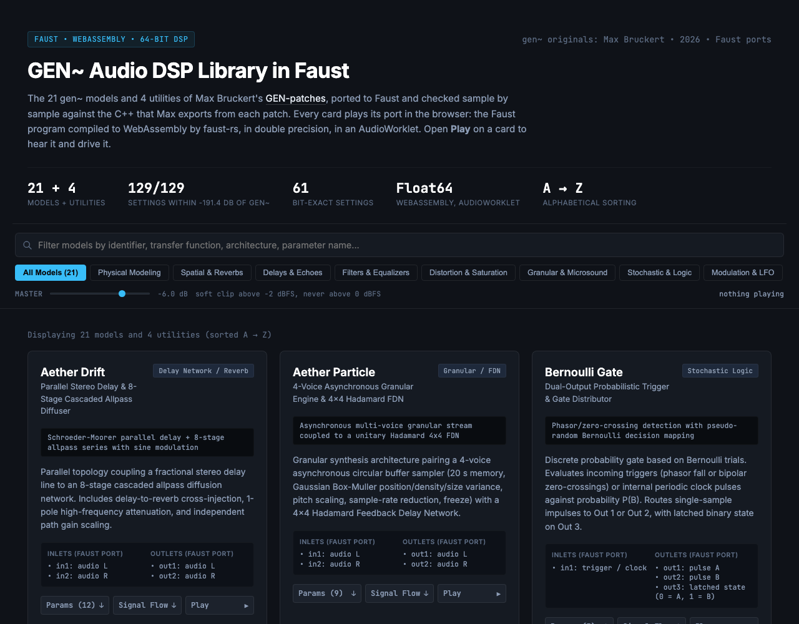
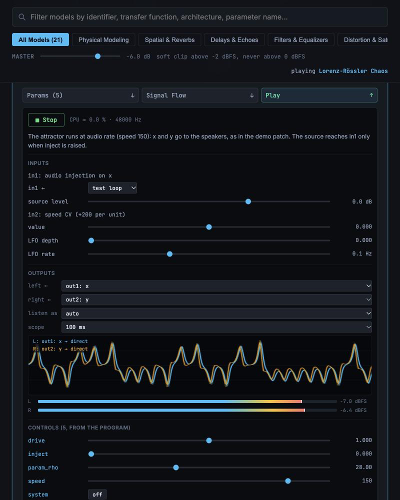

# faust-gen-patches

**Les 21 modèles gen~ et les 4 utilitaires de [GEN-patches](../GEN-patches) (Max Bruckert) en Faust, chacun vérifié échantillon par échantillon contre le C++ que Max exporte lui-même du patch original : 129 réglages, dont 61 identiques au bit près, les autres entre −191 et −319 dB du pic.**

*English version: [README.md](README.md).* · **Jouer chaque modèle dans le navigateur : https://sletz.github.io/faust-gen-patches/web/**

GEN-patches est une bibliothèque de patchs `gen~` (GenExpr) pour Max/MSP : réverbérations et réseaux de lignes à retard bouclées, filtres à rétroaction sans délai (ZDF), corde en guide d'ondes, hystérésis magnétique, attracteurs étranges, synthèse granulaire et pulsar, générateurs stochastiques, LFO. Ce dépôt est la même bibliothèque en Faust, un programme par patch ([dsp/](dsp/)), avec de quoi montrer qu'il calcule ce que calcule gen~.

- **La référence est gen~ lui-même.** Max 9.2.1 a exporté le C++ de chaque `.gendsp` (`exportcode`, piloté par un patch : [scripts/export_gen.py](scripts/export_gen.py)) ; [ref/gen_ref.cpp](ref/gen_ref.cpp) rend ces exports hors ligne avec genlib.
- **Bruit compris.** Le `noise()` de genlib est un xoshiro256+ initialisé sur l'horloge : deux exécutions ne donnent jamais la même chose. [scripts/patch_export.py](scripts/patch_export.py) remplace chaque appel `noise()` d'un export par la lecture d'un flux fourni, et chaque port Faust prend ses bruits en signaux : `process` les tire de générateurs Faust, `det` les reçoit en entrées supplémentaires. Le test donne les mêmes flux aux deux côtés : les modèles stochastiques (nuages granulaires, salves de Poisson, marches aléatoires, LFO échantillonnés-bloqués) sont eux aussi comparés échantillon par échantillon.
- **Les opérateurs de genlib en Faust**, [dsp/genops.lib](dsp/genops.lib) : `wrap`, `fold`, `phasor`, `cycle` (la table de 16384 cosinus et la phase sur 32 bits), `dcblock`, `sah`, `accum`, `slide`, `safediv`, `fixnan`… et le `Delay` de genlib, dont les lectures reproduisent l'arithmétique de l'anneau : la fraction d'interpolation est le double même que calcule genlib, et les cases lues au-delà de la tête d'écriture sont celles qu'il lit.
- **Aussi économe que gen~** : le C++ Faust tourne en moyenne 1,10 fois plus vite que le C++ exporté par Max (§4).
- **Utilisable là où l'était gen~** : les patchers de démonstration de GEN-patches avec les ports Faust dans `faustgen~` ([max/](max/), §5), et la page catalogue avec chaque modèle compilé en WebAssembly et jouable dans le navigateur ([web/](web/), §6).
- **Chaque port s'accorde avec son export** à −191 dB du pic ou mieux, sur tous les réglages de la suite ; 61 des 129 réglages sont identiques au bit près. Chaque programme compile aussi avec le compilateur Faust C++, reste fini en simple précision et donne les mêmes échantillons quelle que soit la taille de bloc.

## Sommaire

1. [Les modèles](#1-les-modèles)
2. [Comment un port est vérifié](#2-comment-un-port-est-vérifié)
3. [Résultats](#3-résultats)
4. [Coût CPU](#4-coût-cpu)
5. [Les patchs Max](#5-les-patchs-max)
6. [La page web](#6-la-page-web)
7. [Ce que les ports ont appris sur Faust](#7-ce-que-les-ports-ont-appris-sur-faust)
8. [Ce que les ports ont trouvé dans les patchs](#8-ce-que-les-ports-ont-trouvé-dans-les-patchs)
9. [Ce qui diffère de l'original](#9-ce-qui-diffère-de-loriginal)
10. [Utilisation](#10-utilisation)
11. [Fichiers](#11-fichiers)

## 1. Les modèles

| modèle | entrées/sorties | ce que c'est | pire écart (dB) |
|---|---|---|---|
| [aether-drift](dsp/aether-drift.dsp) | 2/2 | délais parallèles et 8 passe-tout modulés | −207 |
| [aether-particle](dsp/aether-particle.dsp) | 2/2 | échantillonneur granulaire asynchrone à 4 voix sur un tampon de 20 s, FDN Hadamard 4×4 | −227 |
| [bernoulli-gate](dsp/bernoulli-gate.dsp) | 1/3 | aiguillage de portes par épreuve de Bernoulli | identique au bit |
| [cswitch-tremolo](dsp/cswitch-tremolo.dsp) | 2/4 | hacheur granulaire, enveloppe trapézoïdale, résonateur échantillonné-bloqué | −261 |
| [curvature-shaper](dsp/curvature-shaper.dsp) | 2/2 | courbe en S symétrique et son inverse exacte | −319 |
| [delays-delays](dsp/delays-delays.dsp) | 2/20 | délai à 32 prises, 16 sorties spatiales, filtre en échelle, ducking | −191 |
| [erbeverb-clone](dsp/erbeverb-clone.dsp) | 2/2 | réverbération FDN Hadamard 4×4 | −238 |
| [frost-machine](dsp/frost-machine.dsp) | 2/2 | pré-diffuseurs, réservoir chorus, fuzz, ducking | −214 |
| [householder-fdn-16](dsp/householder-fdn-16.dsp) | 2/2 | FDN de Householder à 16 lignes | −242 |
| [lorenz-rossler-chaos](dsp/lorenz-rossler-chaos.dsp) | 2/4 | attracteurs de Lorenz et de Rössler, RK4 | identique au bit |
| [offset-spline-random](dsp/offset-spline-random.dsp) | 2/4 | marche aléatoire bornée, spline à 6 points | −290 |
| [poisson-cloud](dsp/poisson-cloud.dsp) | 2/3 | salves d'impulsions de Poisson | identique au bit |
| [precision-svf-48db](dsp/precision-svf-48db.dsp) | 2/2 | 4 étages SVF TPT en cascade par canal | −280 |
| [pulsar-synth](dsp/pulsar-synth.dsp) | 2/2 | synthèse pulsar de Curtis Roads | −239 |
| [sature-delay](dsp/sature-delay.dsp) | 2/2 | délai lo-fi : bitcrush ou affaissement de bande, égaliseur tilt, diffusion | −221 |
| [tape-hysteresis](dsp/tape-hysteresis.dsp) | 2/2 | hystérésis de Jiles-Atherton | −277 |
| [ufo](dsp/ufo.dsp), [ufo-core](dsp/ufo-core.dsp), [ufo-core-simple](dsp/ufo-core-simple.dsp) | 2/1, 12/1, 6/1 | LFO multi-formes avec courbure et rampsmooth (d'après Dric et Maurizio Giri) | identique au bit |
| [volt-drama](dsp/volt-drama.dsp) | 2/2 | double waveshaper, passe-bas 4 pôles, unisson à 4 voix, délai | −237 |
| [volt-syphon](dsp/volt-syphon.dsp) | 2/2 | modulateur en anneau sous-alimenté | −262 |
| [waveguide-string](dsp/waveguide-string.dsp) | 2/2 | corde en guide d'ondes à 4 voix, dispersion, saturation du chevalet | −273 |
| [zdf-diode-ladder](dsp/zdf-diode-ladder.dsp) | 2/2 | échelle à diodes façon TB-303 | −247 |
| [lp_butterworth](dsp/lp_butterworth.dsp), [hp_butterworth](dsp/hp_butterworth.dsp) | 1/1 | utilitaires Butterworth 24 dB/oct ([dsp/butterworth.lib](dsp/butterworth.lib)) | −247 |

Chaque programme garde les noms des paramètres gen~ comme libellés des curseurs, les plages et valeurs par défaut de gen~, les entrées et sorties dans l'ordre de gen~, et commence par un commentaire qui dit ce qu'il calcule et ce qu'il hérite du patch (§8). Les trois patchs UFO partagent [dsp/ufo.lib](dsp/ufo.lib) : ufo-core-simple est le cœur de phase, ufo ajoute six formes d'onde et l'étage de sortie dans un gen imbriqué, ufo-core est ufo mis à plat pour RNBO avec des entrées ajoutées aux paramètres (entrées à zéro, les deux exports rendent les mêmes échantillons).

## 2. Comment un port est vérifié

[scripts/test_gen.py](scripts/test_gen.py), pour chaque modèle de [scripts/models/](scripts/models/) (un fichier par modèle : réglages, entrée, sites de bruit) et chaque réglage :

1. l'entrée est construite (pour les effets, un signal de test : un accord de dents de scie avec enveloppe, des salves de bruit, des clics et une fin silencieuse pour les queues ; des impulsions de synchronisation, des portes, des rampes ou des CV pour les générateurs et modulateurs), ainsi qu'un flux de bruit uniforme par site `noise()` (un site appelé deux fois par échantillon en prend deux) ;
2. `build/ref/<modèle>`, l'export, la rend à 48 kHz par blocs de 64, les paramètres fixés par le `setparameter` de gen~, les changements placés à des échantillons exacts (`--at`) ;
3. faustprobe (faust-rs) rend la définition `det` du port, en double précision, avec la même entrée, les mêmes bruits, paramètres et changements ;
4. chaque sortie est comparée : le plus grand |gen − faust| sur le rendu, en dB du pic de cette sortie dans le rendu de gen. La tolérance est de −180 dB pour tous les réglages.

La vérification rejette ce qu'elle doit : retirer le repliement de l'anneau de la lecture à 4 points de genops.lib fait tomber sature-delay à −36 dB ; changer de 6e-7 un coefficient de l'interpolation cubique fait tomber waveguide-string à −148 dB (d'où −180 dB plutôt que −120 : tous les ports sont sous −191 dB).

## 3. Résultats

Tout est dans [results/results.md](results/results.md) (écrit par `make test`, avec les versions et la machine) : 129 réglages, 129 passent.

- **Identiques au bit (61 réglages)** : bernoulli-gate, lorenz-rossler-chaos (192000 échantillons d'un système chaotique, six réglages), poisson-cloud, les trois patchs UFO (46 réglages : chaque forme d'onde, la courbure, le mode one-shot, le rampsmooth), et un réglage de zdf-diode-ladder et de volt-syphon.
- **−239 à −319 dB** : la plupart des modèles. Ces écarts sont le dernier bit de quelques échantillons : un `pow` de libm qui diffère d'un ulp de celui d'Apple (curvature-shaper, −319 dB), une somme que le normaliseur de Faust réassocie (§7).
- **−191 à −227 dB** : les longues réverbérations et les délais, où un ulp d'écart recircule. Dans delays-delays (−191 dB, 1e-11), l'anneau de genlib compte 2^21 cases, sa fraction d'interpolation n'est donc exacte qu'à 2^-31, et un ulp d'écart sur le temps d'une prise fait passer la fraction à la valeur voisine.
- Chaque programme compile avec le compilateur Faust C++ (`make check`), rend des échantillons finis en simple précision (96000 échantillons de bruit blanc) et passe les `--check block=1,7 --check reset` de faustprobe.

## 4. Coût CPU

Mesuré par `make cost` ([scripts/bench_cpu.py](scripts/bench_cpu.py), tableau dans [results/cpu.md](results/cpu.md)) : pour chaque modèle, le C++ exporté par Max (avec le bruit de genlib, inchangé) contre le C++ du `process` du port Faust produit par le compilateur Faust C++ et par faust-rs, tous trois compilés par Apple clang 21 en `-O3 -ffp-contract=off`, exécutés sur un Apple M5 à 48 kHz par blocs de 64, chaque entrée nourrie du même bruit, contrôles à leur valeur par défaut, seul l'appel de calcul chronométré, meilleur de trois passes prises à tour de rôle (et le JIT Cranelift de faustprobe, pour information).

- **En moyenne, les ports Faust coûtent ce que coûtent les exports gen~** : moyenne géométrique des rapports de vitesse 1,10 (faust C++ sur gen~) et 1,14 (faust-rs C++), de 0,61 à 5,4.
- **Moins chers en Faust** : bernoulli-gate (5,4 fois plus rapide), offset-spline-random (1,8), les utilitaires Butterworth (1,65), ufo-core (1,5), frost-machine (1,25), ufo (1,16) ; à 10 % près pour douze autres (les FDN, le SVF, les délais, l'hystérésis, le modulateur en anneau, l'échelle à diodes).
- **Plus chers en Faust** : aether-particle (0,61), lorenz-rossler-chaos (0,61), pulsar-synth (0,66), volt-drama (0,81), aether-drift et waveguide-string (0,88). Deux causes, mesurées sur l'attracteur : le `keep()` qui le rend identique au bit (§7) coûte un facteur d'environ 1,4 (sans lui, le même programme tourne 1,4 fois plus vite, sans plus être identique au bit), et les blocs `if` de gen~ n'exécutent que la branche prise, là où un `select2` de Faust calcule les deux (l'attracteur calcule Lorenz et Rössler à chaque échantillon ; pulsar-synth chaque forme d'onde et chaque fenêtre ; aether-particle ses quatre voix, qu'elles jouent ou non).
- Le JIT de faustprobe fait tourner les mêmes programmes à environ la moitié de la vitesse du C++.
- Ce que cela ne mesure pas : dans Max, gen~ compile son code avec son propre JIT et faustgen~ avec LLVM, pas avec clang `-O3` ; ce sont les coûts des deux codes C++, tels qu'un patch gen~ exporté ou un programme Faust les ont dans un plugin ou sur une Daisy.

## 5. Les patchs Max

[max/](max/) contient les 21 patchers de démonstration de GEN-patches avec les ports Faust à la place de gen~, écrits par [max/convert_patches.py](max/convert_patches.py) avec [py2max](https://github.com/shakfu/py2max) (`make max`). Ouvrez-en un dans Max avec le package [faustgen](https://faust.grame.fr) installé : rien d'autre n'est nécessaire, le code Faust est dans le patch.

- **`gen~ @gen <modèle>` devient `faustgen~`**, dont le code source est le port (`dsp/<modèle>.dsp`) avec ses bibliothèques locales (genops.lib, ufo.lib, butterworth.lib) intégrées en `environment { }`, compilé en double précision comme calcule gen~ ; même identifiant, même place, mêmes entrées et sorties signal, si bien que tous les câbles restent. Double-cliquez dessus pour lire ou modifier le code Faust. `make max-check` compile chaque source embarquée et la compare à `dsp/<modèle>.dsp` échantillon par échantillon : les 21 sont identiques, et compilent avec le compilateur Faust C++ qu'embarque faustgen~.
- **Les `attrui` deviennent des boîtes nombre.** gen~ présente ses paramètres comme des attributs, que les démos modifient avec des `attrui` ; faustgen~ les reçoit en messages (`<label> <valeur>`, par label, nom court ou chemin). Chaque attrui qui pilote gen~ devient une boîte nombre avec la plage du contrôle Faust, sa valeur initiale affichée au chargement, qui envoie `<paramètre> $1` par un `prepend` caché ; elle garde l'identifiant de l'attrui, de sorte que les câbles qui y entrent et les objets `preset` (dont les données sont converties) fonctionnent toujours. Tout autre message que le patch envoie au DSP est vérifié par le script contre les contrôles Faust.
- **Cas particuliers** :
  - cswitch-tremolo tourne en `mc.gen~ @chans 2`, deux instances sur les deux canaux d'un câble MC. `mc.faustgen~` est multicanal dans l'autre sens (une instance dont les entrées sont les canaux) : le patch fait donc tourner [max/cswitch-tremolo-mc2.dsp](max/cswitch-tremolo-mc2.dsp), les deux instances dans un seul programme avec des bruits indépendants, suivi de `mc.separate~ 2 2 2 2`, qui redonne les quatre sorties MC ;
  - gen~ présente aussi ses variables `History` comme des attributs, et trois démos avaient un attrui sur l'une d'elles (lorenz-rossler-chaos `x`, waveguide-string `h_pick_ph1/2`, zdf-diode-ladder `h_env`) : l'état d'un programme Faust ne se règle pas de l'extérieur, ces attrui sont remplacés par un commentaire ;
  - delays-delays lie son `buffer~` de prises à gen~ (`buf_taps`) ; le programme Faust garde la table que la démo calcule au chargement, la liaison est donc retirée et le v8ui qui réécrit le tampon ne change plus les prises (un commentaire le dit).
- **Ce que Faust apporte aux patchs** : les paramètres gardent les plages avec lesquelles les démos les pilotent (l'export bornait à [0, 1] ceux déclarés sans plage, §8) : les six formes d'onde d'ufo, ses décalages et gains, le filtre et l'étalement de delays-delays atteignent leurs valeurs prévues.
- **Non vérifié dans Max lui-même** : les patchs sont vérifiés par le script (ports, câbles, sources), pas ouverts ni joués.

## 6. La page web

[web/](web/) est la page catalogue de GEN-patches (son docs/index.html : apparence, recherche, catégories, tiroirs Params et Signal Flow) avec chaque modèle jouable dans le navigateur : `make web` compile chaque programme de dsp/ en WebAssembly avec faust-rs (`-lang wasm -double`) dans web/dsp, `make web-serve` sert le dépôt, puis ouvrez <http://127.0.0.1:8766/web/>. Les quatre utilitaires sont ajoutés, chaque carte indique le pire écart de son port à l'export gen~, et un troisième tiroir, **Play**, fait tourner le port Faust dans un AudioWorklet ([web/gen-processor.js](web/gen-processor.js), avec le chargeur wasm de faust-elements). Un bouton **Diagram** ouvre le diagramme de blocs du port.

- Le tiroir Play est construit depuis le JSON du programme : curseurs, menus et interrupteurs avec leurs unités (double-clic pour revenir à la valeur par défaut). Chaque entrée reçoit un générateur choisi d'après l'en-tête du programme et le patch de démonstration ([web/drive.js](web/drive.js)) : pour les effets une boucle de test (un accord de dents de scie, des salves de bruit et des clics, puis du silence pour les queues), du bruit, une sinusoïde, un fichier audio ou le micro ; pour les autres des rampes, des horloges avec un bouton (Pluck, Start, Stop, Trigger, Sync) et des CV avec un LFO.
- Deux sorties vont aux haut-parleurs, choisies parmi toutes (delays-delays en a 20) ; les signaux de contrôle (les LFO UFO, l'attracteur, les marches aléatoires, les impulsions de Bernoulli) s'entendent comme la hauteur ou l'amplitude d'un son de test, ou comme des clics, et s'affichent sur un oscilloscope avec des vumètres et la charge CPU du worklet. Un gain général et un écrêtage doux gardent la sortie sous 0 dBFS. Un seul modèle joue à la fois ; `?play=<modèle>` ouvre le tiroir d'une carte, `?mute` coupe les haut-parleurs.
- Le bouton Diagram ouvre une visionneuse ([web/diagram.js](web/diagram.js)) sur le diagramme de blocs que faust-rs dessine du programme (`--svg`) : `process`, puis, par un clic sur une boîte bleu foncé, le diagramme replié derrière elle, jusqu'aux primitives ; un clic sur le fond revient en arrière, le chemin depuis `process` est affiché en fil d'Ariane, le diagramme se zoome (boutons, Ctrl + molette, pincement) et se déplace (glisser). `?diagram=<modèle>` l'ouvre. faust-rs écrit un fichier SVG par diagramme replié : 7174 fichiers et 66 Mo pour les 25 programmes (3978 pour delays-delays seul ; déplié, un seul programme est un fichier de plus de 1 Go), donc [scripts/web_svg.py](scripts/web_svg.py) empaquette les fichiers d'un programme en un JSON gzippé, web/svg/<modèle>.json.gz (2,2 Mo pour les 25), que la visionneuse charge à l'ouverture du diagramme et décompresse dans le navigateur. Le paquet est refusé si un lien nomme un fichier absent ou si un fichier n'est pas atteignable depuis `process`.
- `make web-check` fait tourner chaque programme wasm sous node avec les générateurs de la page pendant une seconde : les 25 rendent une sortie finie et audible (aussi à 44,1, 96 et 192 kHz). Dans le navigateur, chaque modèle a été lancé dans un AudioContext neuf et sa sortie lue sur un AnalyserNode : finie et non silencieuse pour les 25. Les sources fichier audio et micro n'ont pas été testées (elles demandent un sélecteur de fichier ou une autorisation). Il lit aussi chaque paquet de diagrammes comme le fait la visionneuse : 25 paquets, 7174 diagrammes, chacun un SVG avec un viewBox, 39489 liens qui nomment tous un fichier de leur paquet ; dans le navigateur les 7174 diagrammes sont analysés sans erreur, et la visionneuse a été parcourue au clic (ouvrir, revenir, fil d'Ariane, zoom, déplacement) en largeur de bureau et de téléphone.
- web/models-data.js est généré par [scripts/web_models.py](scripts/web_models.py) depuis la documentation de GEN-patches et results/results.json. Les plus grosses mémoires wasm : delays-delays 100 Mo, aether-particle 68 Mo (lignes à retard dimensionnées pour 192 kHz). delays-delays, le modèle le plus coûteux, prend environ la moitié du temps du worklet à 48 kHz.
- La version publiée, https://sletz.github.io/faust-gen-patches/web/, est la branche main du dépôt déployée par [.github/workflows/pages.yml](.github/workflows/pages.yml) : web/ avec les fichiers vers lesquels pointent ses cartes (dsp/, max/, ref/gendsp/, results/). Rien n'y est compilé : après la modification d'un port, lancez `make web` et commitez web/dsp et web/svg.

<p align="center"> </p>

## 7. Ce que les ports ont appris sur Faust

- **Le normaliseur et le dernier bit.** Faust réécrit `x / ma.SR` en `x * (1/SR)`, qui diffère d'une division pour environ un quart des valeurs (4468 sur 20000 mesurées), factorise `a*x + b*x` en `(a+b)*x` et regroupe les constantes à travers les produits. La plupart des ports n'en souffrent pas (−250 dB). Deux si : lorenz-rossler-chaos divergeait de gen~ après 1 à 58 échantillons, et zdf-diode-ladder près de l'auto-oscillation amplifiait le dernier bit jusqu'à −179 dB. genops.lib fournit `divsr(x)` (une vraie division par la fréquence d'échantillonnage) et `keep(x) = max(x, -1e308)` (une identité que le normaliseur ne traverse pas), avec lesquelles les ports suivent l'ordre des opérations de l'export : l'attracteur est identique au bit sur 4 s, l'échelle à −247 dB.
- **`-(x)` n'est pas une négation** mais l'application partielle `_ - x` ; une fonction appelée avec un argument de moins est aussi une application partielle, acceptée sans un mot (un `scale` à cinq arguments : +18 dB d'écart jusqu'à ce qu'on le trouve).
- **`no.noise` est un seul signal** : deux usages sont le même bruit. Les ports prennent des flux indépendants (`g.noises(K, k)`).
- **L'ordre des instructions de gen~** : une `History` lue après avoir été écrite dans l'échantillon donne la nouvelle valeur, un `Delay` lu avant son écriture a un délai minimal d'un échantillon, les blocs `if` deviennent des `select2` sur chaque valeur qu'ils modifient, et un `&&` du C court-circuite (le rampsmooth d'ufo en dépend, §8).

## 8. Ce que les ports ont trouvé dans les patchs

Les ports reproduisent ce que calcule gen~, particularités comprises ; elles sont documentées dans l'en-tête de chaque programme.

- **L'export borne à [0, 1] les paramètres déclarés sans plage.** Dans Max, `Param smooth(100);` n'est pas borné ; dans le C++ exporté, `setparameter` le ramène dans [0, 1] (la valeur par défaut est conservée). Sont touchés : ufo (tous ses paramètres : seules les formes cos et triangle sont sélectionnables), delays-delays (tous ses paramètres : l'état de chargement de son propre patch de démonstration est hors d'atteinte), poisson-cloud (`occurrences(16, min=1)` est borné à [1, 1]), offset-spline-random, curvature-shaper et les utilitaires Butterworth. Les ports donnent à ces curseurs les plages des patchs de démonstration ; la suite les teste dans ce que l'export accepte (les autres formes d'onde UFO par les entrées d'ufo-core, qui passent par le même code).
- **Des en-têtes qui décrivent une autre version** : aether-particle, frost-machine, precision-svf-48db, poisson-cloud, volt-drama et offset-spline-random documentent des paramètres, plages ou sorties que leur code n'a pas (l'en-tête de frost-machine décrit quatre entrées et un limiteur ; celui de precision-svf-48db une résonance et des modes passe-bande/réjecteur, alors que son amortissement est fixé à √2 et que son mode est un fondu passe-haut/passe-bas).
- **Des comportements probablement involontaires** :
  - aether-drift lit deux délais du réservoir à leur maximum plus un LFO : la moitié positive de la modulation est écrêtée ;
  - le `decay` (un « T60 ») de householder-fdn-16 est appliqué une fois par tour dans les lignes : le temps de décroissance dépend de la taille et de la fréquence d'échantillonnage ;
  - le « passe-haut 40 Hz » de sature-delay réinjecte des entrées passées, pas des sorties : un RIF de gain 0,998 ;
  - le Box-Muller d'offset-spline-random utilise −0,25 au lieu de −2 (écart-type 0,354) ;
  - le résonateur de cswitch-tremolo n'est pas normalisé en crête (+46 dB à 20 Hz, 0 dB à 4 kHz) ;
  - l'entrée « reset/sync » de pulsar-synth ne remet jamais la phase à zéro ;
  - dans aether-particle, `freeze` et `clear` écrivent tous deux des zéros à la tête d'écriture : le tampon de 20 s se vide, il n'est pas figé ;
  - le one-shot d'ufo fait tourner sa phase à l'envers (un `!- 0`), et son accumulateur n'est jamais replié : en simple précision la période est trop longue de 1 % au bout de 10 s à 3,7 Hz ;
  - le `delta(a)==0 && delta(b)==0 && delta(c)==0` du codebox rampsmooth court-circuite : le deuxième et le troisième `delta` ne se mettent à jour que certains échantillons, et un changement de fréquence relance la rampe deux fois (un port qui les met à jour à chaque échantillon s'écarte de −58 dB) ;
  - delays-delays fait passer ses 16 sorties par un seul bloqueur de continu partagé, dont l'état court de sortie en sortie, et sa sortie 16 ne reçoit jamais de prise ;
  - lorenz-rossler-chaos avec ρ au-delà d'environ 51 sort de la boîte ±100 dès sa première excursion et se réinitialise sans fin.
- **Un tampon externe que l'export ne déclare pas** : delays-delays lit ses prises dans un `buffer~` rempli par un script v8ui de son patch de démonstration. [scripts/delays_delays_buffer.py](scripts/delays_delays_buffer.py) porte la fonction `compute()` de ce script avec l'état sauvegardé du patch, la référence reçoit le résultat par `gen_ref --buffer`, et le port le garde en 32 constantes.

## 9. Ce qui diffère de l'original

- **Bruit** : les programmes utilisent les générateurs de bruit de Faust, pas le xoshiro256+ de genlib ; la distribution est la même (uniforme dans [−1, 1)), les tirages non. La comparaison utilise la forme `det`, qui reçoit les bruits de gen~ en entrée.
- **La table des prises de delays-delays** est le contenu que son patch de démonstration donne au tampon au chargement ; l'interface du patch la réécrit en cours de jeu, le programme Faust l'a figée.
- **Plages des paramètres** : les curseurs prennent les plages des patchs de démonstration là où le gendsp n'en donne pas (§8), au-delà de ce que l'export accepte.
- **Précision** : la suite tourne en double précision, comme gen~ ; les programmes tournent aussi en simple précision (finis partout), où ils héritent des limites des patchs eux-mêmes (l'accumulateur non replié d'ufo).
- Non portés : les patchers de démonstration Max et leurs interfaces, le catalogue HTML de l'original.

## 10. Utilisation

```sh
make test       # chaque port contre son export : results/results.md (environ 40 s)
make quick      # la même chose sur des rendus plus courts
make check      # chaque programme compile (faustprobe et le compilateur Faust C++)
make max        # max/<modèle>.maxpat : les patchers de démonstration avec faustgen~ (py2max)
make max-check  # les sources qui y sont embarquées contre dsp/, échantillon par échantillon
make cost       # coût CPU, export gen~ contre Faust : results/cpu.md (machine au repos)
make web        # web/dsp/*.wasm, web/svg/*.json.gz : chaque programme et ses diagrammes de blocs pour la page web (faust-rs)
make web-check  # chaque programme wasm sous node avec les entrées de la page, chaque paquet de diagrammes
make web-serve  # http://127.0.0.1:8766/web/
make ref        # build/ref/<modèle> : les exports, déterministes, dans le moteur de rendu de référence
make export     # redemander à Max l'export C++ de chaque gendsp (ouvre Max)
python3 scripts/test_gen.py sature-delay ufo   # quelques modèles
```

Prérequis : un dépôt [faust-rs](https://github.com/grame-cncm/faust-rs) à côté de celui-ci (`FAUST_RS=...` sinon) avec un faustprobe compilé en release (`cargo build --release -p cranelift-ffi --bin faustprobe`), le compilateur Faust C++ pour `make check`, python3 avec numpy, un compilateur C++17, un faust-rs compilé en release (`cargo build --release -p compiler --bin faust-rs`) et node pour la page web ; Max 9 seulement pour refaire l'export ; pour `make max`, un dépôt [py2max](https://github.com/shakfu/py2max) (`PY2MAX=...`) et le dépôt GEN-patches à côté de celui-ci (`GEN_PATCHES=...`), et Max avec le package faustgen pour ouvrir le résultat.

Dans un autre programme, chaque modèle est un programme Faust, et ses morceaux s'importent :

```faust
process = component("aether-drift.dsp");      // avec -I dsp
g = library("genops.lib");                    // les opérateurs de genlib
```

## 11. Fichiers

| fichier | |
|---|---|
| [dsp/](dsp/) | les ports, un `.dsp` par gendsp (`process`, et `det` avec les bruits en entrée) ; [genops.lib](dsp/genops.lib), [butterworth.lib](dsp/butterworth.lib), [ufo.lib](dsp/ufo.lib) |
| [ref/gendsp/](ref/gendsp/) | les gendsp originaux, inchangés (GEN-patches, commit `a0f2311`), et le patcher qui les exporte |
| [ref/export/](ref/export/) | le C++ qu'en a exporté Max 9.2.1, avec genlib (`gen_dsp/`) |
| [ref/gen_ref.cpp](ref/gen_ref.cpp) | le moteur de rendu d'un export : paramètres, changements programmés, flux de bruit, tampons externes |
| [ref/buffers/](ref/buffers/) | le contenu du `buf_taps` de delays-delays |
| [scripts/patch_export.py](scripts/patch_export.py) | rend un export déterministe (sites de bruit, compteur d'échantillons, tampons non déclarés) |
| [scripts/test_gen.py](scripts/test_gen.py), [scripts/models/](scripts/models/) | la comparaison et les réglages de chaque modèle |
| [scripts/export_gen.py](scripts/export_gen.py) | pilote Max pour exporter les gendsp |
| [scripts/delays_delays_buffer.py](scripts/delays_delays_buffer.py) | la table des prises de delays-delays, d'après le script de son patch de démonstration |
| [web/](web/), [scripts/web_check.mjs](scripts/web_check.mjs), [scripts/web_models.py](scripts/web_models.py), [scripts/web_svg.py](scripts/web_svg.py) | la page web, sa vérification sous node, ses données de modèles, ses diagrammes de blocs |
| [max/](max/) | les patchers de démonstration avec faustgen~, [convert_patches.py](max/convert_patches.py) qui les écrit, [cswitch-tremolo-mc2.dsp](max/cswitch-tremolo-mc2.dsp) |
| [scripts/bench_cpu.py](scripts/bench_cpu.py), [tools/](tools/) | le coût CPU : les bancs d'un export gen~ et d'un programme Faust |
| [results/](results/) | results.md, results.json (la comparaison), cpu.md, cpu.json (le coût CPU) |

## Licence

Les programmes Faust et les scripts : MIT ([LICENSE](LICENSE)), comme GEN-patches. Les modèles sont de Max Bruckert (2026 ; ufo d'après Dric et Maurizio Giri). Le C++ exporté de [ref/export/](ref/export/) est généré par Max et sous double licence de Cycling '74 (Cycling '74 License for Max-Generated Code for Export, ou GPLv3 : voir l'en-tête de chaque fichier) ; c'est la référence des tests, il ne fait pas partie des programmes Faust.
