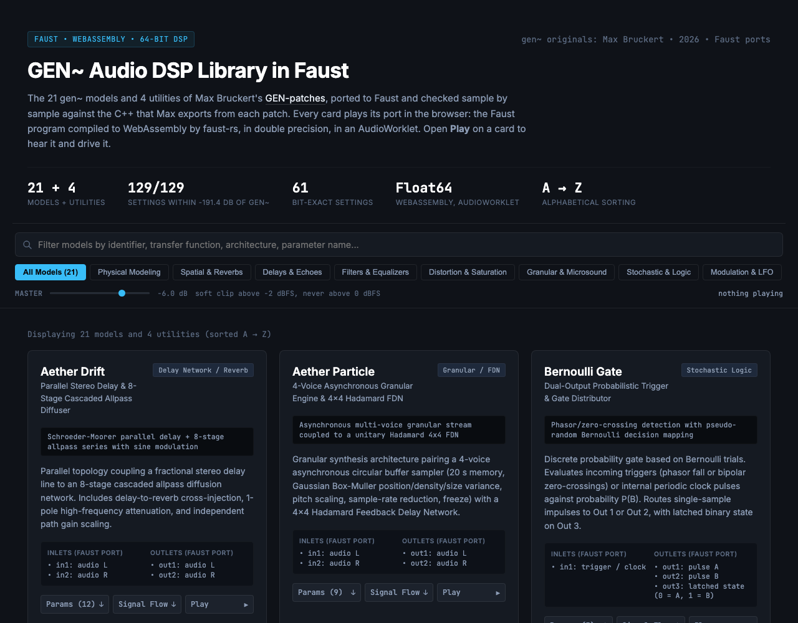
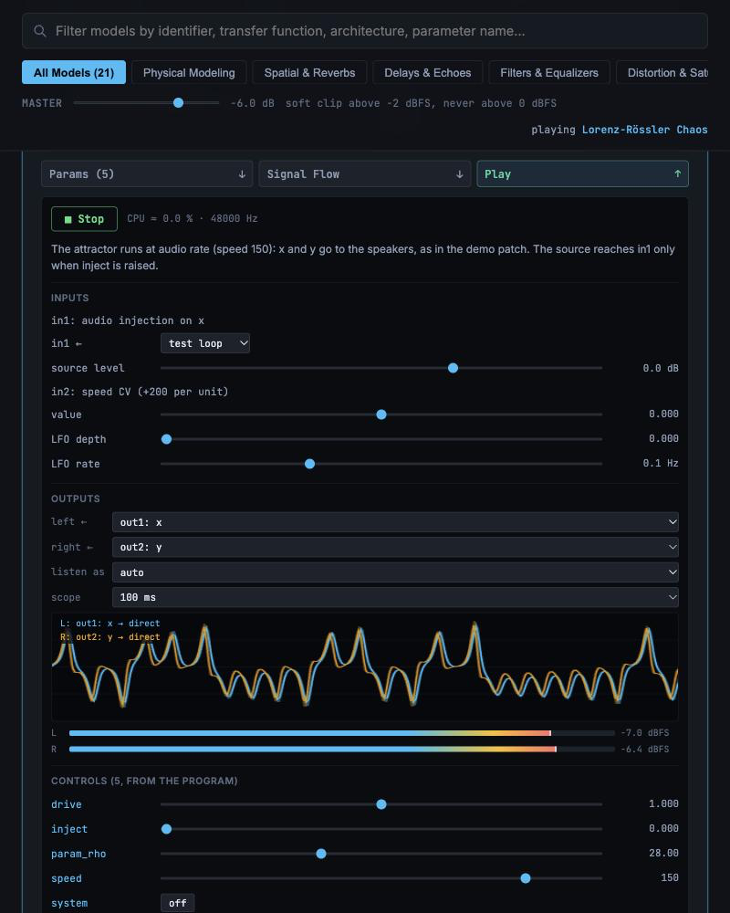

# faust-gen-patches

**The 35 gen~ patches of Max Bruckert's [GEN-patches](../GEN-patches) in Faust, each checked sample by sample against the C++ that Max itself exports from the original patch: 171 settings, 96 of them bit-exact, the others within −191 to −328 dB of the peak.**

*Version française : [README.fr.md](README.fr.md).* · **Play every model in the browser: https://sletz.github.io/faust-gen-patches/web/**

GEN-patches is a library of `gen~` (GenExpr) patches for Max/MSP: reverbs and feedback delay networks, multichannel panners, zero-delay-feedback filters, a filter bank and multiband distortion, a waveguide string and a modal resonator, magnetic hysteresis, strange attractors, granular, stutter and pulsar synthesis, phase modulation, stochastic generators, LFOs. This repository is the same library in Faust, one program per patch ([dsp/](dsp/)), and the means to show it computes what gen~ computes.

- **The reference is gen~ itself.** Max 9.2.1 exported the C++ of every `.gendsp` (GEN-patches commit `5d0a432`) (`exportcode`, driven by a patch: [scripts/export_gen.py](scripts/export_gen.py)); [ref/gen_ref.cpp](ref/gen_ref.cpp) renders those exports offline with genlib.
- **Noise included.** genlib's `noise()` is a xoshiro256+ seeded by the clock: no two runs agree. [scripts/patch_export.py](scripts/patch_export.py) turns every `noise()` call site of an export into a read of a given stream, and every Faust port takes its noises as signals: `process` feeds them from Faust noise generators, `det` takes them as extra inputs. The test gives both sides the same streams, so the stochastic models (granular clouds, Poisson bursts, random walks, sample-and-hold LFOs) are compared sample by sample too.
- **genlib's operators in Faust**, [dsp/genops.lib](dsp/genops.lib): `wrap`, `fold`, `phasor`, `cycle` (the 16384-point cosine table and the 32-bit phase), `dcblock`, `sah`, `accum`, `slide`, `safediv`, `fixnan`… and genlib's `Delay`, whose readers reproduce its ring arithmetic, so that the interpolation fraction is the very double genlib computes, and the slots it reads beyond the write head.
- **As cheap as gen~**: the Faust C++ runs on average 1.04 times as fast as the C++ Max exports (32 single-instance models), and computes the mc.gen~ panners several times more cheaply (§4).
- **Usable where gen~ was**: the demo patchers of GEN-patches with the Faust ports in `faustgen~` ([max/](max/), §5), and the catalogue page with every model compiled to WebAssembly and playable in the browser ([web/](web/), §6).
- **Every port agrees with its export** to −191 dB of the peak or better, at every setting of the suite; 96 of the 171 settings are bit-exact. Every program also compiles with the C++ Faust compiler, stays finite in single precision, and gives the same samples at any block size.

## Contents

1. [The models](#1-the-models)
2. [How a port is checked](#2-how-a-port-is-checked)
3. [Results](#3-results)
4. [CPU cost](#4-cpu-cost)
5. [The Max patches](#5-the-max-patches)
6. [The web page](#6-the-web-page)
7. [What the ports taught about Faust](#7-what-the-ports-taught-about-faust)
8. [What the ports found in the patches](#8-what-the-ports-found-in-the-patches)
9. [What differs from the original](#9-what-differs-from-the-original)
10. [Running it](#10-running-it)
11. [Files](#11-files)

## 1. The models

| model | in/out | what it is | worst error (dB) |
|---|---|---|---|
| [adm_panner](dsp/adm_panner.dsp) | 3/8 | mc.gen~: circular or linear cosine-beam panner, air damping | −305 |
| [aether-drift](dsp/aether-drift.dsp) | 2/2 | parallel delays and 8 modulated allpasses | −214 |
| [aether-particle](dsp/aether-particle.dsp) | 2/2 | 4-voice asynchronous granular sampler on a 20 s buffer, 4×4 Hadamard FDN | −226 |
| [bernoulli-gate](dsp/bernoulli-gate.dsp) | 1/3 | Bernoulli trial gate router | bit-exact |
| [cswitch-tremolo](dsp/cswitch-tremolo.dsp) | 2/4 | granular chopper, trapezoidal envelope, sample-and-hold band-pass | −268 |
| [curvature-shaper](dsp/curvature-shaper.dsp) | 2/2 | symmetric S-curve and its exact inverse | bit-exact |
| [delays-delays](dsp/delays-delays.dsp) | 2/20 | 32-tap delay, 16 spatial outputs, ladder filter, ducking | −191 |
| [driller](dsp/driller.dsp) | 4/3 | stochastic beat-repeat delay: six taps, rests, degradation, capture | bit-exact |
| [erbeverb-clone](dsp/erbeverb-clone.dsp) | 2/2 | 4×4 Hadamard FDN reverb | −239 |
| [fdn_multireverb](dsp/fdn_multireverb.dsp) | 8/8 | mc.gen~: a 4×4 Hadamard FDN per channel, decorrelated by the channel | −234 |
| [fhickup](dsp/fhickup.dsp) | 4/2 | overdrive, random amplitude chopper, morphing telephone filter | bit-exact |
| [filterbank-8](dsp/filterbank-8.dsp) | 2/4 | 8 octave-spaced resonant band-passes with soft clipping | bit-exact |
| [fm-supermod](dsp/fm-supermod.dsp) | 4/2 | stereo bell phase modulation with self-feedback, Risset ratios | bit-exact |
| [frost-machine](dsp/frost-machine.dsp) | 2/2 | pre-diffusers, chorus tank, fuzz, ducking | −216 |
| [grainer](dsp/grainer.dsp) | 4/4 | envelope-triggered grain bursts | bit-exact |
| [householder-fdn-16](dsp/householder-fdn-16.dsp) | 2/2 | 16-line Householder FDN | −246 |
| [lorenz-rossler-chaos](dsp/lorenz-rossler-chaos.dsp) | 2/4 | Lorenz and Rössler attractors, RK4 | bit-exact |
| [modeldrive](dsp/modeldrive.dsp) | 3/2 | four distortion models morphed (overdrive, fold, quantizer, wrap) | bit-exact |
| [multiband-drive](dsp/multiband-drive.dsp) | 2/5 | 3-band crossover, the morphing distortion on each band | bit-exact |
| [offset-spline-random](dsp/offset-spline-random.dsp) | 2/4 | bounded random walk, 6-point spline | −287 |
| [poisson-cloud](dsp/poisson-cloud.dsp) | 2/3 | Poisson pulse bursts | bit-exact |
| [precision-svf-48db](dsp/precision-svf-48db.dsp) | 2/2 | 4 cascaded TPT SVF stages per channel | −280 |
| [pulsar-synth](dsp/pulsar-synth.dsp) | 2/2 | Curtis Roads pulsar synthesis | −239 |
| [rings](dsp/rings.dsp) | 3/4 | 24-mode modal resonator after Mutable Instruments Rings | bit-exact |
| [sature-delay](dsp/sature-delay.dsp) | 2/2 | lo-fi delay: bitcrush or tape sag, tilt EQ, diffusion | −209 |
| [skipper](dsp/skipper.dsp) | 2/4 | stochastic CD-skip looper and stutter | bit-exact |
| [spatial-dbap](dsp/spatial-dbap.dsp) | 4/32 | mc.gen~: 3D distance-based amplitude panning | −280 |
| [tape-hysteresis](dsp/tape-hysteresis.dsp) | 2/2 | Jiles-Atherton hysteresis | −276 |
| [ufo](dsp/ufo.dsp) | 2/1 | multi-waveform LFO with curvature and rampsmooth (after Dric and Maurizio Giri) | bit-exact |
| [volt-drama](dsp/volt-drama.dsp) | 2/2 | dual waveshaper, 4-pole lowpass, 4-voice unison, delay | −239 |
| [volt-syphon](dsp/volt-syphon.dsp) | 2/2 | voltage-starved ring modulator | −261 |
| [waveguide-string](dsp/waveguide-string.dsp) | 2/2 | 4-voice waveguide string, dispersion, bridge saturation | −298 |
| [zdf-diode-ladder](dsp/zdf-diode-ladder.dsp) | 2/2 | TB-303 style diode ladder | bit-exact |
| [lp_butterworth](dsp/lp_butterworth.dsp), [hp_butterworth](dsp/hp_butterworth.dsp) | 1/1 | 24 dB/oct Butterworth filters ([dsp/butterworth.lib](dsp/butterworth.lib)) | −247 |

Every program keeps the gen~ parameter names as slider labels, the gen~ ranges and defaults, the inputs and outputs in gen~'s order, and opens with a comment that says what it computes and what it inherits from the patch (§8). The three mc.gen~ patches (one gen~ instance per channel, which reads its channel with `mc_channel` and the number of channels with `mc_channelcount`) are ported as their N instances in one program, one output per channel: N = 8 for adm_panner and fdn_multireverb (no demo patch), 32 for spatial-dbap as in its demo patch; N is a constant at the top of the program, as `@chans` is on mc.gen~.

## 2. How a port is checked

[scripts/test_gen.py](scripts/test_gen.py), for every model of [scripts/models/](scripts/models/) (one file per model: settings, input, noise sites) and every setting:

1. the input is built (a test signal for the effects: a saw chord with an envelope, noise bursts, clicks and a silent end for the tails; sync pulses, gates, ramps or CVs for the generators and modulators), and one uniform noise stream per `noise()` call site (a site called twice per frame takes two);
2. `build/ref/<model>`, the export, renders it at 48 kHz in blocks of 64, the parameters set by gen~'s `setparameter`, changes scheduled at exact frames (`--at`); for an mc.gen~ patch, once per channel, with `mc_channel` = 1..N and `mc_channelcount` = N (the export makes them parameters), its outputs side by side;
3. faustprobe (faust-rs) renders the `det` definition of the port, in double precision, with the same input, noises, parameters and schedule;
4. each output is compared: the largest |gen − faust| over the render, in dB of that output's peak in gen's render. The tolerance is −180 dB for every setting.

The check rejects what it should: removing the ring wrap from the 4-point delay reader of genops.lib takes sature-delay to −36 dB; changing a cubic interpolation coefficient by 6e-7 takes waveguide-string to −148 dB (hence −180 dB rather than −120: every port is below −191 dB).

## 3. Results

All in [results/results.md](results/results.md) (written by `make test` with the versions and the machine): 171 settings, 171 pass.

- **Bit-exact (96 settings)**: 15 of the 35 ports at every setting, bernoulli-gate, curvature-shaper, driller, fhickup, filterbank-8, fm-supermod (chaotic self-FM included), grainer, lorenz-rossler-chaos (192000 frames of a chaotic system, seven settings), modeldrive, multiband-drive, poisson-cloud, rings (24 modes ringing for seconds), skipper, ufo (24 settings: every waveform, curvature, one-shot, the rampsmooth), zdf-diode-ladder (self-oscillation included), and settings of offset-spline-random and volt-syphon. Most of them needed `keep()` and true divisions to follow the export's order of operations (§7), and a reference that computes the libm calls the export writes: built with clang's builtins, the export's `pow(2, x)` became `exp2(x)` and a `sin` and a `cos` of one angle a single `__sincos_stret`, each one ulp off at some arguments (the Makefile builds the reference with `-fno-builtin`: 79 settings were bit-exact without it, 96 with it, none worse).
- **−234 to −328 dB**: most of the others, the last bit of a few samples: a sum or a product the Faust normalizer reassociates where no `keep()` holds it (§7).
- **−191 to −227 dB**: the long reverbs and delays, where an ulp of difference recirculates. In delays-delays (−191 dB, 1e-11) genlib's ring holds 2^21 samples, so its interpolation fraction is exact to 2^-31 only, and an ulp of difference in a tap's delay time moves the fraction to the neighbouring value.
- Every program compiles with the C++ Faust compiler (`make check`), renders finite samples in single precision, and passes faustprobe's `--check block=1,7 --check reset`.

## 4. CPU cost

Measured by `make cost` ([scripts/bench_cpu.py](scripts/bench_cpu.py), table in [results/cpu.md](results/cpu.md)): for each model, the C++ that Max exported (genlib's own noise, untouched) against the C++ of the Faust port's `process` by the C++ Faust compiler and by faust-rs, all three built by Apple clang 21 with `-O3 -ffp-contract=off`, run on an Apple M5 at 48 kHz in blocks of 64, every input fed the same noise, controls at their defaults, the compute call alone timed, best of three runs taken in turn (and faustprobe's Cranelift JIT, for information). For the three mc.gen~ patches the gen~ side is the N instances that `mc.gen~ @chans N` runs (mc_channel 1..N), the Faust side the one program that computes them.

- **On average the Faust ports cost what the gen~ exports cost**: over the 32 single-instance models, geometric mean of the speed ratios 1.04 (faust C++ over gen~) and 1.12 (faust-rs C++), ranging from 0.56 to 5.7.
- **Cheaper in Faust**: bernoulli-gate (5.7 times faster), rings (2.9: its 24 modes unrolled in Faust, a loop over two `Data` in gen~), the Butterworth filters (1.65 and 1.9), grainer (1.47), offset-spline-random (1.22), frost-machine and multiband-drive (1.2), cswitch-tremolo, ufo (1.1); within 10 % for a dozen others.
- **The mc.gen~ patches**: spatial-dbap is 51 times cheaper, adm_panner 3.5 times: each gen~ instance computes the distances (and the DBAP normalization) to every loudspeaker again, where the program computes them once for its N outputs; fdn_multireverb, whose instances share nothing, costs 0.83.
- **Dearer in Faust**: lorenz-rossler-chaos (0.56), aether-particle (0.60), driller (0.61), skipper (0.70), pulsar-synth (0.73), volt-drama (0.76), waveguide-string and householder-fdn-16 (0.8). Three causes. The `keep()` that keeps the export's order of operations (§7): it costs the attractor a factor of about 1.4, and in the delay readers of genops.lib it costs offset-spline-random 1.92 → 1.22, sature-delay 1.03 → 0.86, waveguide-string 0.87 → 0.80 (measured with and without it). gen~'s `if` blocks run only the branch taken, where a Faust `select2` computes both (the attractor computes Lorenz and Rössler at every sample; pulsar-synth every waveform and window; aether-particle, driller and skipper their voices and taps whether they play or not). And what changed in the patches: householder-fdn-16 now computes an `exp` per line per sample for its T60, in both (0.81, against 1.05 for the first port).
- faustprobe's JIT runs the same programs at about half the speed of the C++.
- What this does not measure: inside Max, gen~ compiles its code with its own JIT and faustgen~ with LLVM, not with clang `-O3`; these are the costs of the two C++ codes, as an exported gen~ patch or a Faust program has them in a plugin or on a Daisy.

## 5. The Max patches

[max/](max/) holds the 32 demo patchers of GEN-patches with the Faust ports in place of gen~, written by [max/convert_patches.py](max/convert_patches.py) with [py2max](https://github.com/shakfu/py2max) (`make max`). Open one in Max with the [faustgen](https://faust.grame.fr) package installed: nothing else is needed, the Faust code is in the patch.

- **`gen~ @gen <model>` becomes `faustgen~`**, every one of a patch (spatial-dbap's demo drives it with a lorenz-rossler-chaos, lowpasss_highpass holds both Butterworth filters), its source code the port (`dsp/<model>.dsp`) with its local libraries (genops.lib, butterworth.lib) embedded as `environment { }`, compiled in double precision as gen~ computes; same id, place, inlets and signal outlets, so every patch cord stays. Double-click it to read or edit the Faust code. `make max-check` compiles every embedded source and compares it with `dsp/<model>.dsp` sample for sample: all 33 are identical, and compile with the C++ Faust compiler that faustgen~ embeds.
- **The `attrui`s become number boxes.** gen~ shows its parameters as attributes, which the demos edit with `attrui`; faustgen~ takes them as messages (`<label> <value>`, by label, shortname or path). Each attrui that drives gen~ becomes a number box with the Faust control's range, its initial value shown at load, sending `<param> $1` through a hidden `prepend`; it keeps the attrui's id, so the cords into it and the `preset` objects (whose data are converted) still work. Every other message the patch sends to the DSP is checked against the Faust controls by the script.
- **Particular cases**:
  - cswitch-tremolo runs as `mc.gen~ @chans 2`, two instances on the two channels of an MC cable. `mc.faustgen~` is multichannel the other way (one instance whose inputs are the channels), so the patch runs [max/cswitch-tremolo-mc2.dsp](max/cswitch-tremolo-mc2.dsp), the two instances in one program with independent noises, followed by `mc.separate~ 2 2 2 2`, which gives back the four MC outlets;
  - spatial-dbap runs as `mc.gen~ @chans 32`, its four inlets (audio, X, Y, Z) shared by the 32 instances; the port is the 32 instances in one program, so `mc.faustgen~` runs it with an `mc.pack~ 4` in front gathering the four signals into the channels of its one inlet, and its outlet carries the 32 channels to the `mc.dac~` as before. The demo's `buffer~ spk_pos` and its CSV loader (dbap_csv_loader.js) are left in place, but the Faust program does not read the buffer: it keeps the patch's fallback ring of loudspeakers (§9); the loader's `num_speakers` and `room_scale` messages still reach it;
  - gen~ shows its `History` variables as attributes too, and three demos had an attrui on one (lorenz-rossler-chaos `x`, waveguide-string `h_pick_ph1/2`, zdf-diode-ladder `h_env`): the state of a Faust program is not settable from outside, these attruis are replaced by a comment;
  - delays-delays binds its `buffer~` of taps to gen~ (`buf_taps`); the Faust program holds the table the demo computes at load, so the binding is removed and the v8ui that rewrites the buffer no longer changes the taps (a comment says so).
- **What Faust gives the patches**: the parameters keep gen~'s ranges; the two `smooth` parameters declared with a minimum only (§8) get a slider up to 4800 samples.
- **Not verified in Max itself**: the patches are checked by the script (ports, cords, sources), not opened and played by it.

## 6. The web page

[web/](web/) is GEN-patches' catalogue page (its docs/index.html: look, search, categories, Params and Signal Flow drawers) with every model playable in the browser: `make web` compiles every program of dsp/ to WebAssembly with faust-rs (`-lang wasm -double`) into web/dsp, `make web-serve` serves the repository, then open <http://127.0.0.1:8766/web/>. Each card shows the worst error of its port against the gen~ export, and a third drawer, **Play**, runs the Faust port in an AudioWorklet ([web/gen-processor.js](web/gen-processor.js), with faust-elements' wasm loader). A **Diagram** button opens the block diagram of the port.

- The Play drawer is built from the program's JSON: sliders, menus and toggles with their units (double-click resets). Each input gets a generator chosen from the program's header and the demo patch ([web/drive.js](web/drive.js)): for the effects a test loop (a saw chord, noise bursts and clicks, then silence for the tails), noise, a sine, an audio file or the microphone; for the others ramps, clocks with a button (Pluck, Start, Stop, Trigger, Sync) and CVs with an LFO.
- Two outputs go to the speakers, chosen among all of them (delays-delays has 20); control signals (the UFO LFOs, the attractor, the random walks, the Bernoulli pulses) are heard as the pitch or the amplitude of a test tone, or as clicks, and shown on a scope with level meters and the worklet's CPU load. A master gain and a soft clip keep the output below 0 dBFS. One model plays at a time; `?play=<model>` opens a card's drawer, `?mute` silences the speakers.
- The Diagram button opens a viewer ([web/diagram.js](web/diagram.js)) on the block diagram faust-rs draws of the program (`--svg`): `process`, then, by a click on a dark blue box, the diagram folded behind it, down to the primitives; a click on the background goes back, the path from `process` is shown as a trail, the diagram zooms (buttons, Ctrl + wheel, pinch) and pans (drag). `?diagram=<model>` opens it. faust-rs writes one SVG file per folded diagram: 13623 files and 120 MB for the 35 programs (delays-delays alone 3978; unfolded, a single program is a file of more than 1 GB), so [scripts/web_svg.py](scripts/web_svg.py) packs the files of a program into one gzipped JSON, web/svg/<model>.json.gz (4.0 MB for the 35), which the viewer loads when the diagram is opened and inflates in the browser. The pack is refused if a link names a missing file or a file cannot be reached from `process`.
- `make web-check` runs every wasm program under node with the page's own drive for one second: all 35 render finite output with sound at the speakers. In the browser, each of the first 25 programs was started in a fresh AudioContext and its output read from an AnalyserNode: finite and not silent; the ports added with GEN-patches `5d0a432` have been checked under node only. The audio-file and microphone sources were not tested (they need a file picker or a permission). It also reads every diagram pack as the viewer does: 35 packs, 13623 diagrams, each an SVG with a viewBox, 71934 links that all name a file of their pack; in the browser the diagrams of the first 25 programs parse, and the viewer was walked by clicks (open, back, trail, zoom, pan) at desktop and phone widths.
- web/models-data.js is generated by [scripts/web_models.py](scripts/web_models.py) from GEN-patches' docs and results/results.json. The largest wasm memories: delays-delays 100 MB, aether-particle 63 MB (lines and buffers sized for 192 kHz). delays-delays, the costliest model, takes about half of the worklet's time at 48 kHz.
- The published version, https://sletz.github.io/faust-gen-patches/web/, is the repository's main branch deployed by [.github/workflows/pages.yml](.github/workflows/pages.yml): web/ with the files its cards link to (dsp/, max/, ref/gendsp/, results/). Nothing is compiled there: after a change of a port, run `make web` and commit web/dsp and web/svg.

<p align="center"> </p>

## 7. What the ports taught about Faust

- **The normalizer and the last bit.** Faust rewrites `x / ma.SR` as `x * (1/SR)`, which differs from a division for about a quarter of the values (4468 of 20000 measured), factors `a*x + b*x` into `(a+b)*x`, and folds constants across products. Most ports do not care (−250 dB). Two do: lorenz-rossler-chaos diverged from gen~ after 1 to 58 samples, and zdf-diode-ladder near self-oscillation amplified the last bit to −179 dB. genops.lib has `divsr(x)` (a true division by the sample rate) and `keep(x) = max(x, -1e308)` (an identity the normalizer does not see through), with which the ports follow the export's order of operations: the attractor is bit-exact over 4 s, the ladder within −247 dB.
- **The delay readers too.** genops.lib's readers computed genlib's read position r = size + reader − d and its fraction a = r − int(r) as written, and the normalizer folded them into size + reader − (d + int(r)), and regrouped the products of cubic_interp's coefficients: a few ulps off genlib's fraction, which a reverb recirculates. The readers and the interpolators now hold every intermediate with `keep()`: aether-drift went from −207 to −214 dB, householder-fdn-16 from −241 to −246, waveguide-string from −273 to −298, and the new ports that had needed their own copies of the readers use the shared ones. `tdiv(n, d)` generalizes `divsr` to any positive divisor that changes with the controls only, which Faust would otherwise turn into a product by its inverse.
- **`-(x)` is not a negation** but the partial application `_ - x`; a function called with one argument too few is a partial application too, accepted without a word (a `scale` with five arguments: +18 dB of error until found).
- **`no.noise` is one signal**: two uses are the same noise. The ports take independent streams (`g.noises(K, k)`).
- **gen~'s statement order**: a `History` read after it is written in the frame gives the new value, a `Delay` read before its write has a minimum delay of one sample, `if` blocks become `select2` on every value they update, and a C `&&` short-circuits (the rampsmooth of ufo depends on it, §8).

## 8. What the ports found in the patches

The ports reproduce what gen~ computes, quirks included; these are documented in the header of each program. GEN-patches `60c8b87` fixed most of what the first port had found (aether-drift's clamped modulation, householder-fdn-16's decay per trip, sature-delay's FIR "high-pass", offset-spline-random's Box-Muller, cswitch-tremolo's unnormalized resonator, pulsar-synth's sync, aether-particle's freeze, delays-delays' shared DC blocker and silent output 16, lorenz-rossler-chaos's reset loop, parameters without a range, headers of another version); the ports follow the new code.

- **The export bounds parameters declared without a maximum.** In Max, `Param smooth(240, min=1);` is bounded below only; in the C++ export, `setparameter` clamps it to [1, 1] (a parameter without min or max to [0, 1]); the default is kept. This now touches only the `smooth` of adm_panner and spatial-dbap, tested at its default. The export also drops a Param's `name=` attribute: fdn_multireverb's `Param mix_rev(25, name="mix")` is `mix` in Max, `mix_rev` in the export.
- **An mc.gen~ patch in the export**: `mc_channel` and `mc_channelcount` become parameters (1 by default), which the suite sets for each channel.
- **What the export computes and the GenExpr does not say**: in rings, the loop's `if (cur_stiff < 0) cur_stiff *= 0.93; else cur_stiff *= 0.98;` is missing from the exported C++ (gen~'s code generation drops it), so the stretch grows by the same stiffness at every mode and the partials spread linearly (1 + k·stiff) instead of converging as in Rings. The port computes what the export computes.
- **Behaviour that is probably not intended**:
  - delays-delays' new per-channel DC blockers assign `prev_in = peek(dc_in, n)`, and `prev_in` is also the History of the onset trigger: the trigger compares bus 16 of two frames back to 0 instead of the previous input level, so while bus 16 is silent (the default tap table) it fires again every 100 ms as long as the input is loud, and once taps reach bus 16 it no longer fires;
  - cswitch-tremolo's new band-pass is meant as (1 − r²)/2 · (x[n] − x[n−2]), but its History x2 is written with the current input each frame and holds x[n−1]: one zero at DC only;
  - fhickup computes a spread from `stereo_spread` and never uses it;
  - modeldrive and multiband-drive at model 100 sit exactly on the quantizer: the advertised wrap model is never reached; their bands (multiband-drive, filterbank-8) mute at −40 dB where the headers say −24 and −48 dB;
  - grainer's dry signal is the input delayed by the fade length, not the input; driller's capture mode grows its delay by one slice per loop up to the 190000-sample clamp instead of holding a loop;
  - skipper's buffers are 288000 samples (6 s at 48 kHz) whatever the sample rate, and its `kill_capture` silences the loop until the next capture without clearing it;
  - ufo's one-shot runs its phase backwards, and its accumulator is never wrapped: in single precision the period is 1 % long after 10 s at 3.7 Hz;
  - ufo's rampsmooth tests `delta(a)==0 && delta(b)==0 && delta(c)==0`, which short-circuits, so the second and third `delta` update only on some frames, and a frequency change restarts the ramp twice (a port that updates them every frame is off by −58 dB).
- **Headers**: frost-machine's lists a soft-clip limiter its code does not have, modeldrive's calls the file pisound-drive.gendsp.
- **External buffers**: delays-delays reads its taps from a `buffer~` filled by a v8ui script of its demo patch, which the export leaves undeclared. [scripts/delays_delays_buffer.py](scripts/delays_delays_buffer.py) ports that script's `compute()` with the patch's saved state, the reference gets the result through `gen_ref --buffer`, and the port holds it as 32 constants. spatial-dbap reads its loudspeaker positions from `buffer~ spk_pos` when it holds enough frames, filled from a CSV by its demo's script; without it (the unbound Buffer of the reference, one frame) the patch places the loudspeakers on a ring of radius 2, and so does the port.

## 9. What differs from the original

- **Noise**: the programs use Faust's noise generators, not genlib's xoshiro256+; the distribution is the same (uniform in [−1, 1)), the streams are not. The comparison uses the `det` form, which takes gen~'s noises as inputs.
- **delays-delays' tap table** is the content its demo patch gives the buffer at load; the patch's interface rewrites it at run time, the Faust program has it fixed.
- **spatial-dbap's loudspeakers** are the patch's fallback ring: the program has no `spk_pos` buffer, so a CSV layout cannot be loaded (in its demo patch, whose `buffer~ spk_pos` is empty until a CSV is read, gen~ places every loudspeaker at the origin until then).
- **The mc.gen~ patches** have their number of channels fixed when the program is compiled (N at the top of the program), where mc.gen~ takes it from `@chans`.
- **Parameter ranges**: the two `smooth` parameters declared with a minimum only get a slider up to 4800 samples, beyond what the export accepts (§8).
- **Precision**: the suite runs in double precision, as gen~ does; the programs also run in single precision (finite everywhere), where they inherit the patches' own limits (ufo's unwrapped accumulator).
- Not ported: the Max demo patchers and their interfaces, the HTML catalogue of the original.

## 10. Running it

```sh
make test       # every port against its export: results/results.md (about 40 s)
make quick      # the same on shorter renders
make check      # every program compiles (faustprobe, faust C++), block sizes 1/7, reset, single precision
make iface-check  # every port's sliders, inputs and outputs against its export
make max        # max/<model>.maxpat: the demo patchers with faustgen~ (py2max)
make max-check  # the sources embedded in them against dsp/, sample for sample
make cost       # CPU cost, gen~ export against Faust: results/cpu.md (idle machine)
make web        # web/dsp/*.wasm, web/svg/*.json.gz: every program and its block diagrams for the web page (faust-rs)
make web-check  # every wasm program under node with the page's inputs, every diagram pack
make web-serve  # http://127.0.0.1:8766/web/
make ref        # build/ref/<model>: the exports, deterministic, in the reference renderer
make readme-check  # the figures of both READMEs against the results (scripts/readme_numbers.py --write)
make verify     # test, check, iface-check, max, max-check, web, web-check, readme-check
make export     # ask Max to export the C++ of every gendsp again (opens Max)
python3 scripts/sync_gen_patches.py            # what changed in GEN-patches since ref/gendsp; --apply
python3 scripts/new_port.py MODEL              # the skeleton of a new port
python3 scripts/first_divergence.py MODEL SETTING   # where a port departs, the export's values there
python3 scripts/dropped_statements.py          # GenExpr assignments the export may have dropped
python3 scripts/test_gen.py sature-delay ufo   # some models
```

Requirements: a [faust-rs](https://github.com/grame-cncm/faust-rs) checkout next to this one (`FAUST_RS=...` otherwise) with a release faustprobe (`cargo build --release -p cranelift-ffi --bin faustprobe`), the C++ Faust compiler for `make check`, python3 with numpy, a C++17 compiler, a release faust-rs (`cargo build --release -p compiler --bin faust-rs`) and node for the web page; Max 9 only to export again; for `make max`, a [py2max](https://github.com/shakfu/py2max) checkout (`PY2MAX=...`) and the GEN-patches checkout next to this one (`GEN_PATCHES=...`), and Max with the faustgen package to open the result.

In another program, every model is a Faust program, and its pieces are importable:

```faust
process = component("aether-drift.dsp");      // with -I dsp
g = library("genops.lib");                    // genlib's operators
```

## 11. Files

| file | |
|---|---|
| [dsp/](dsp/) | the ports, one `.dsp` per gendsp (`process`, and `det` with the noises as inputs); [genops.lib](dsp/genops.lib), [butterworth.lib](dsp/butterworth.lib) |
| [ref/gendsp/](ref/gendsp/) | the original gendsp, unchanged (GEN-patches, commit `5d0a432`), and the patcher that exports them |
| [ref/export/](ref/export/) | the C++ exported by Max 9.2.1 from them, with genlib (`gen_dsp/`) |
| [ref/gen_ref.cpp](ref/gen_ref.cpp) | the renderer of an export: parameters, scheduled changes, noise streams, external buffers |
| [ref/buffers/](ref/buffers/) | the content of delays-delays' `buf_taps` |
| [scripts/patch_export.py](scripts/patch_export.py) | makes an export deterministic (noise sites, frame counter, undeclared buffers) |
| [scripts/test_gen.py](scripts/test_gen.py), [scripts/models/](scripts/models/) | the comparison and the settings of every model (and what moved against the committed results) |
| [scripts/iface_check.py](scripts/iface_check.py) | every port's interface against its export |
| [scripts/new_port.py](scripts/new_port.py) | the skeleton of a new port from its export: sliders, inputs, outputs, noise sites, model file |
| [scripts/sync_gen_patches.py](scripts/sync_gen_patches.py), [ref/GEN-patches.commit](ref/GEN-patches.commit) | what changed in GEN-patches since ref/gendsp was taken, and the update |
| [scripts/first_divergence.py](scripts/first_divergence.py), [scripts/dropped_statements.py](scripts/dropped_statements.py) | the first frame where a port departs from its export and the export's values there; GenExpr statements the export may have dropped |
| [scripts/readme_numbers.py](scripts/readme_numbers.py) | the figures of both READMEs from results/, web/svg and max/ |
| [scripts/export_gen.py](scripts/export_gen.py) | drives Max to export the gendsp |
| [scripts/delays_delays_buffer.py](scripts/delays_delays_buffer.py) | the tap table of delays-delays, from its demo patch's script |
| [web/](web/), [scripts/web_check.mjs](scripts/web_check.mjs), [scripts/web_models.py](scripts/web_models.py), [scripts/web_svg.py](scripts/web_svg.py) | the web page, its check under node, its model data, its block diagrams |
| [max/](max/) | the demo patchers with faustgen~, [convert_patches.py](max/convert_patches.py) that writes them, [cswitch-tremolo-mc2.dsp](max/cswitch-tremolo-mc2.dsp) |
| [scripts/bench_cpu.py](scripts/bench_cpu.py), [tools/](tools/) | the CPU cost: the harnesses of a gen~ export and of a Faust program |
| [results/](results/) | results.md, results.json (the comparison), cpu.md, cpu.json (the CPU cost) |

## License

The Faust programs and the scripts: MIT ([LICENSE](LICENSE)), as GEN-patches. The models are Max Bruckert's (2026; ufo after Dric and Maurizio Giri). The exported C++ in [ref/export/](ref/export/) is generated by Max and dual-licensed by Cycling '74 (Cycling '74 License for Max-Generated Code for Export, or GPLv3: see the header of each file); it is the reference of the tests, not part of the Faust programs.
